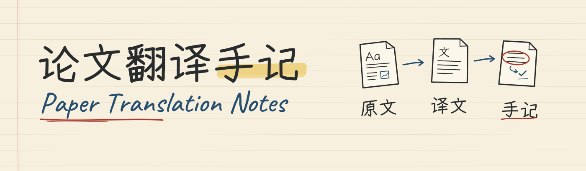
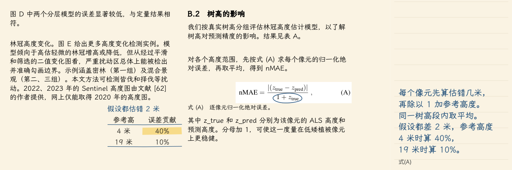

# 论文翻译手记 · Paper Translation Notes



**把英文论文译成中文，把读到一半想写的话留在那一页。** `translate-paper-zh` 是一个 Codex Skill。它把全文排在浅卡其色纸上，保留原图、表格和公式。读到关键处，可以圈一个分母，在表格旁抄两行对照，或沿着方法段画出从输入到输出的几步。

**Read an English paper in Chinese, with room to think on the page.** This Codex skill produces a searchable Chinese reading copy on warm khaki paper. Figures, tables and equations stay close to the translated text. A handwritten note might circle a denominator, compare two rows, or sketch how a method gets from its inputs to its result.

[翻开完整手稿 · Open the 25-page notebook](Paper_Translation_Stimulation/round-07-Open-Canopy/Open-Canopy-CVPR2025-卡其纸精读手稿.pdf) · [试读三张跨学科样页 · Browse three sample pages](#sample-pages)

<a id="margin-note"></a>

## 在公式旁算一遍 · A calculation in the margin

> 假设两个像元都估错 2 米。参考高度是 4 米时，这一项是 2 ÷ (1 + 4) = 40%；换成 19 米，就只有 10%。再看一眼圈出来的分母，树高为什么影响这个指标就清楚了。
>
> Suppose two pixels both miss by 2 m. At a reference height of 4 m, the term is 2 ÷ (1 + 4) = 40%. At 19 m, it is 10%. The circled denominator explains why the same miss counts differently.



这张截图取自 *Open-Canopy* 的 25 页作者版中文手稿。23 则手记分布在 17 页，其余 8 页留白。原文的结论照其语气翻译，读者的假设和追问另写在彩色笔迹里。[第 4 页的模型草图](docs/reading-notes/Open-Canopy-khaki-p04.png) · [原文与署名](Paper_Translation_Stimulation/SOURCES.md)

This crop comes from the 25-page author version of *Open-Canopy*. Its reading copy has 23 notes across 17 pages. Eight pages have no notes. The translation preserves the strength of the authors’ claims. Colored handwriting carries the reader’s examples and open questions. [Model sketch on page 4](docs/reading-notes/Open-Canopy-khaki-p04.png) · [Source and credits](Paper_Translation_Stimulation/SOURCES.md)

<a id="sample-pages"></a>

## 另翻三页 · Three more pages

| 中文手稿 · Reading copy | 这一页值得看什么 · What to look for |
| --- | --- |
| [气象软件 MetSim · Weather software, p. 2](Paper_Translation_Stimulation/round-08-cross-domain/joss-metsim-p02.pdf) | 一天降雨 24 毫米，怎样把它分到每个小时？用两种分配方法读同一张输入输出图。<br>Start with 24 mm of rain in a day. Read the input–output figure alongside two ways of distributing rain over the hours. |
| [野外积雪观测 · Field observations, p. 5](Paper_Translation_Stimulation/round-08-cross-domain/geo-snow-depth-p05-zh-notes.pdf) | 左边 936 个测点，右边 104 个网格均值，来自同一批采样。一个点的含义变了。<br>The same field observations appear as 936 point measurements on the left and 104 grid means on the right. What does one dot represent? |
| [斐波那契恒等式 · Fibonacci identities, p. 1](Paper_Translation_Stimulation/round-08-cross-domain/math-zeckendorf-p01.pdf) | 同一组偏移在 n = 3 时凑巧成立，换成 n = 4 就失效。用两个数读懂“对每个允许的 n”。<br>One choice of offsets works at n = 3 and fails at n = 4. Two substitutions show what “for every admissible n” requires. |

三个链接都是单页选译。整篇手稿、原始版本、图表归属及各篇许可见[样本目录](Paper_Translation_Stimulation/README.md)和[出处说明](Paper_Translation_Stimulation/SOURCES.md)。

Each link opens a one-page translation. The [sample catalog](Paper_Translation_Stimulation/README.md) and [source credits](Paper_Translation_Stimulation/SOURCES.md) give the original editions, page ranges and licenses.

## 自己读一篇 · Try it with your paper

**1. 准备环境 · Set up.** 在 Python 3.11 或更新版本的环境中，从仓库根目录安装已测试的排版依赖。字体随 Skill 提供。

From the repository root, install the tested PDF dependency in a Python 3.11+ environment. The handwriting fonts are included.

```sh
git clone https://github.com/Echoinorbit/PaperTranslation_Skill.git
cd PaperTranslation_Skill
python -m pip install PyMuPDF==1.28.2
```

**2. 在 Codex 里附上英文 PDF · Attach an English PDF in Codex.** 从克隆的仓库打开会话，指向下面的 Skill 文件即可试用。已安装该 Skill 时，可直接用 `$translate-paper-zh` 开头。

Open the cloned repository in Codex, attach your paper and use either prompt below. If the skill is installed, you can start the prompt with `$translate-paper-zh`.

```text
请按 skills/translate-paper-zh/SKILL.md，把这篇英文论文全文译成中文精读手稿。
请在关键推导或实验旁写下读法，保留原图和公式，导出一份 PDF。
```

```text
Follow skills/translate-paper-zh/SKILL.md and translate the entire attached paper
into Simplified Chinese. Keep the original figures and equations, add handwritten
notes beside the key arguments, and export one annotated PDF.
```

**3. 翻开手稿 · Read the result.** 中文正文用霞鹜文楷，中文手记用悠哉，英文手记用 Caveat。短句落在段落或公式附近，较长的推敲写在同页外侧。想用其他能查看 PDF 和运行 Python 的 Agent，可以从仓库的公共入口开始。

LXGW WenKai sets the Chinese body text, Yozai gives Chinese notes a heavier pen stroke, and Caveat handles handwritten English. Short notes sit near their anchors and longer thoughts run down the margin. Other agents with PDF viewing and Python execution can use the same entry point. [Agent instructions](AGENTS.md) · [字体与许可 · Fonts and licenses](skills/translate-paper-zh/assets/fonts/README.md)

## 桌上的工具 · Under the cover

Agent 阅读、翻译和校对，Python 负责盘点源页、保留原图、排版和落笔。每页独立检查栏数、方向和文字层。扫描页或乱码需要看原图识读，复杂多栏可依阅读顺序续排。

The agent reads, translates and checks the paper. Python inventories the source, places the translation and draws the notes. Layout is checked page by page. Scans and broken text layers need visual transcription, and complex columns can reflow in reading order.

| 阶段 · Stage | 输入与输出 · What happens |
| --- | --- |
| `paper.py prepare` | 建立源文清单和原页图，Agent 填写译文。 / Inventories the paper and renders page images for the agent to translate. |
| `paper.py render --notebook-paper` | 从校对过的清单排出卡其纸中文底本。 / Typesets the reviewed translation on khaki paper. |
| `annotate.py --uniform-margin --notebook-paper` | 按这份底本上的文字或坐标落笔，导出手稿。 / Places notes at verified text or coordinate anchors and exports the reading copy. |

[完整使用流程 · Skill](skills/translate-paper-zh/SKILL.md) · [如何精读 · Reading method](skills/translate-paper-zh/references/reading-voice.md) · [手记格式 · Note format](skills/translate-paper-zh/references/reading-notes.md) · [实测记录 · Test notes](docs/iterations.md)

在仓库根目录运行回归测试，或把三个公开样例重新排到一个新目录。第二条命令会生成三页中文底本、逐页核对报告和中英并排图；上面的样页链接打开的是加完手记的成品。

From the repository root, run the tests or reproduce the three public excerpts in a new directory. The second command produces Chinese base pages, QA reports and side-by-side comparisons. The linked reading copies above include the handwritten notes.

```sh
python -m unittest discover -s tests -v
python benchmarks/run.py sample-output
```
